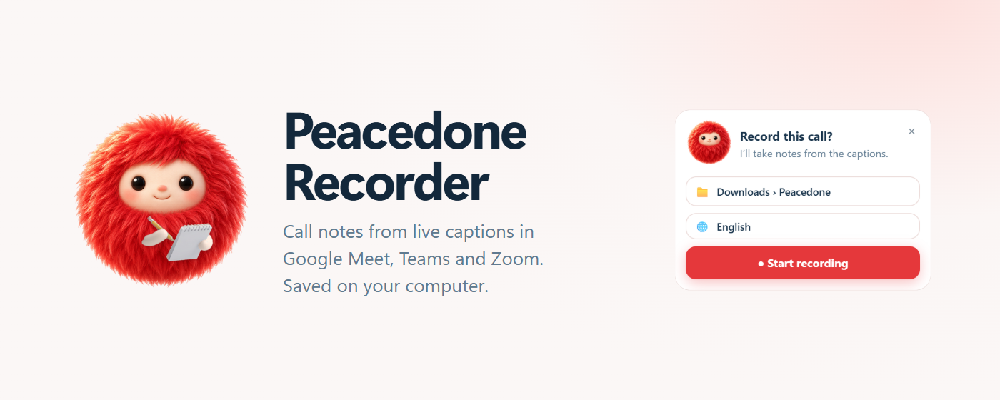
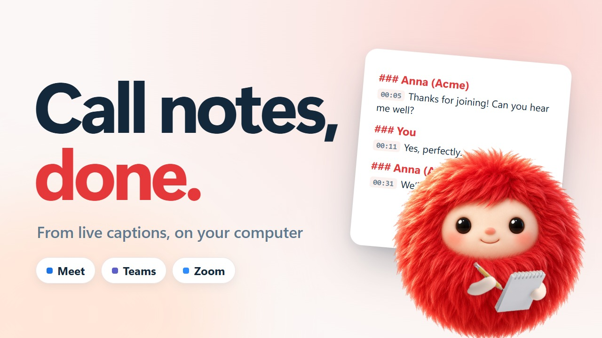
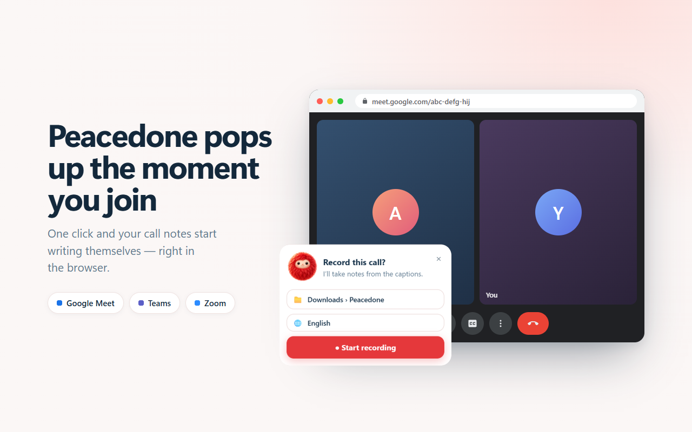
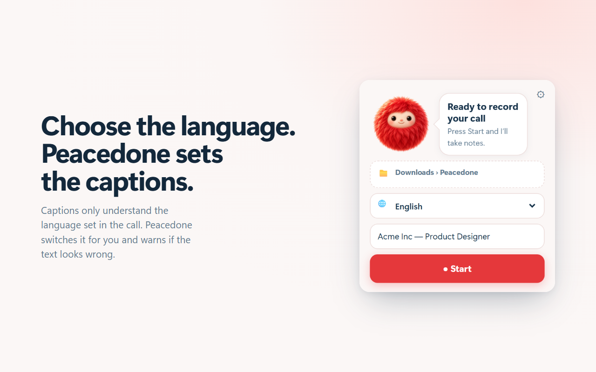
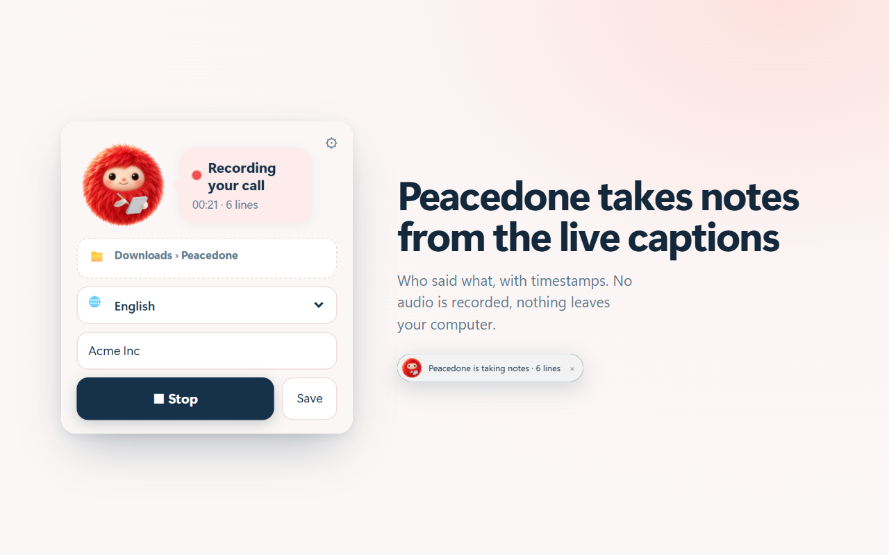
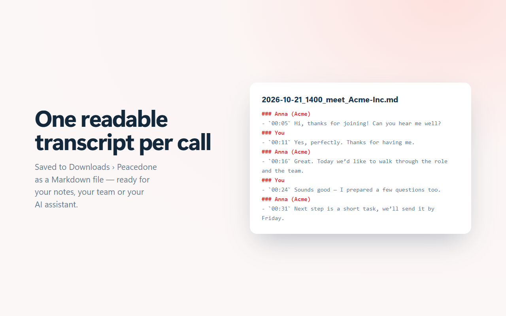

# Peacedone Recorder

Peacedone takes notes on your calls. It reads the **live captions** of Google Meet, Microsoft Teams (web) and
Zoom (web client) and saves a clean transcript — who said what, with timestamps — as a `.md` file on your computer.
No audio is recorded, nothing is sent anywhere: the extension makes no network requests.

The Chrome Web Store version is in review. Until then, install it from here.

*Русская версия — ниже.*

## Download
**[Releases](../../releases/latest) → `Peacedone-Recorder-v0.5.0.zip`** — the extension, ready to load in Chrome.

## Install (2 minutes)
1. Unzip the archive somewhere permanent (e.g. `Documents\Peacedone-Recorder`) — Chrome loads it from there.
   The folder also has **START HERE - How to install.html** with pictures.
2. Open `chrome://extensions` and switch on **Developer mode** (top right).
3. Click **Load unpacked** and select the `Peacedone-Recorder` folder.
4. Pin it: puzzle icon in the toolbar → pin **Peacedone Recorder**.

Works in Chrome, Edge and Brave on Windows. Updates are not automatic: download the new release and replace the folder.

| | |
|---|---|
|  |  |
|  |  |

## Use
1. Join the call **in the browser** (desktop Zoom / Teams apps are invisible to extensions — choose “Join from your browser”).
2. Peacedone pops up on the call page: **Record this call?** → **● Start recording**. Or click the toolbar icon → **● Start**.
3. Pick the **🌐 language of the call** — Peacedone switches the captions to it (captions only recognise the language set in the call).
4. Leave the call or press **■ Stop** — the transcript is saved.

**Where files go:** by default `Downloads › Peacedone`. To save into any folder, click **Choose folder**: the first
time Peacedone offers a one-time **Install helper** (a small setup file, ~10 seconds, no admin rights; if Chrome asks,
choose **Keep**). After that the Windows folder dialog opens and your choice is remembered.

Each call: `YYYY-MM-DD_HHMM_<platform>_<company>.md` + `raw/<same>.json` (raw lines).

## Please note
- **Tell the other people on the call** that you keep notes from the live captions. In many countries recording or
  transcribing without consent is not allowed. You are responsible for how you use transcripts.
- Captions are machine speech recognition: names, numbers and terms can be misheard — check important details.
- Transcripts stay on your computer. Don't share them without the participants' consent.

## Remove
- Extension: `chrome://extensions` → Peacedone Recorder → **Remove**.
- Folder helper (if installed): delete `%LOCALAPPDATA%\Peacedone` and run in a command prompt:
  `reg delete "HKCU\Software\Google\Chrome\NativeMessagingHosts\com.peacedone.recorder" /f`

---

# Peacedone Recorder (RU)

Peacedone ведёт заметки на созвонах: берёт **живые субтитры** Google Meet, Microsoft Teams (веб) и Zoom (веб-клиент)
и сохраняет транскрипт — кто что сказал и когда — файлом `.md` на вашем компьютере. Звук не записывается,
ничего никуда не отправляется: расширение не делает сетевых запросов.

## Скачать и установить
**[Releases](../../releases/latest) → `Peacedone-Recorder-v0.5.0.zip`.** Версия в Chrome Web Store пока на проверке.

## Установка (2 минуты)
1. Распакуйте папку в постоянное место (например, `Документы\Peacedone-Recorder`) — Chrome загружает расширение оттуда.
2. Откройте `chrome://extensions` и включите **Режим разработчика** (справа сверху).
3. **Загрузить распакованное** → выберите папку `Peacedone-Recorder`.
4. Закрепите: значок пазла на панели → булавка у **Peacedone Recorder**.

## Как пользоваться
1. Заходите на звонок **через браузер** (приложения Zoom/Teams для компьютера расширение не видит — выберите «Join from your browser»).
2. На странице звонка всплывёт Peacedone: **Record this call?** → **● Start recording**. Или значок на панели → **● Start**.
3. Выберите **🌐 язык звонка** — Peacedone сам переключит на него субтитры (они распознают только язык, выставленный в звонке).
4. Выйдите из звонка или нажмите **■ Stop** — транскрипт сохранится.

**Куда сохраняется:** по умолчанию `Загрузки › Peacedone`. Чтобы сохранять в любую папку, нажмите **Choose folder**:
в первый раз Peacedone предложит **Install helper** — маленький установщик на ~10 секунд, без прав администратора
(если Chrome спросит — «Сохранить»). Дальше откроется обычное окно выбора папки Windows, выбор запоминается.

## Важно
- **Предупредите собеседников**, что ведёте заметки по субтитрам. Во многих странах запись или расшифровка без согласия
  запрещена; за использование транскриптов отвечаете вы.
- Субтитры — машинное распознавание речи: имена, цифры и термины могут быть услышаны неверно.
- Транскрипты остаются на вашем компьютере. Не пересылайте их без согласия участников.

## Удаление
- Расширение: `chrome://extensions` → Peacedone Recorder → **Удалить**.
- Помощник папок (если ставили): удалите папку `%LOCALAPPDATA%\Peacedone` и выполните в командной строке:
  `reg delete "HKCU\Software\Google\Chrome\NativeMessagingHosts\com.peacedone.recorder" /f`
